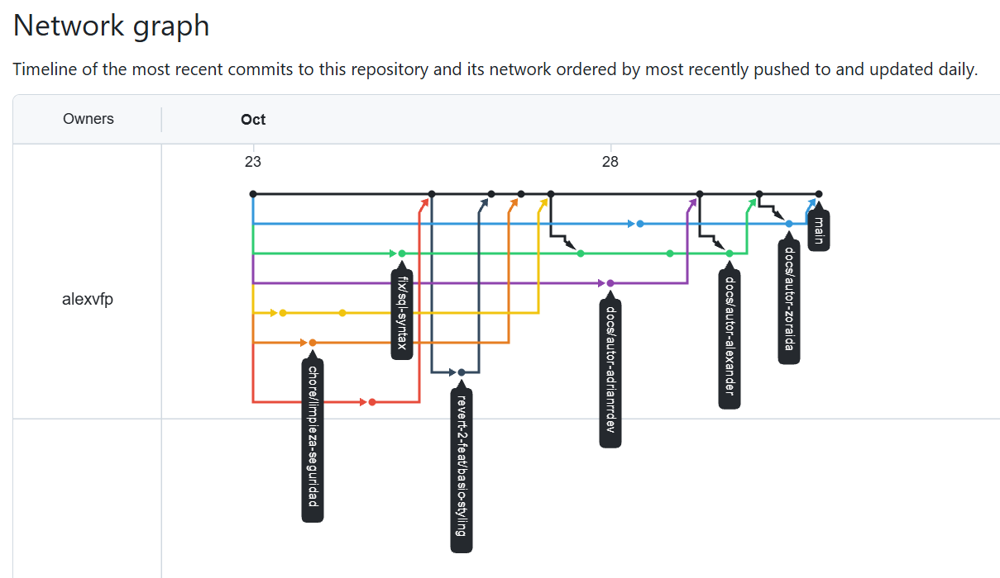

•¿Qué comando habéis usado para sacar config/db.php del repositorio sin borrar el fichero? ¿Sigue la contraseña en el historial? ¿Qué habría que hacer en un proyecto real?
Los comandos que he usado para quitarlo sin borrar el fichero fue: git rm --cached config/db.php , el --cached elimina el archivo pero no lo borra del disco.

•¿Qué comandos habéis usado para descargar la rama de un compañero y probarla en vuestro PC?
git remote add adrian https://github.com/adrianrrdev/ProyectoDespliegue   

•¿Cómo habéis resuelto el conflicto de autoría?
Cuando el primer integrante lo sube sin problemas provoca que el resto al hacer el PR les cree un conflicto debido a que en los 2 ficheros restantes (index.php) se vea modificado la misma línea de código. Lo que hicimos fue que cada uno en la web de github, le diesemos al botón de Resolve Conflicts, editemos la línea de código donde se crea el error, guardemos los cambios que hemos realizado, y confirmamos con un merge.

•Una captura de Insights → Network donde se vean vuestras ramas y cómo se han integrado.

•En el LOG.md, una tabla con el nombre de cada miembro y su usuario de GitHub.
<table>
  <tr>
    <th>Nombre</th>
    <th>User GITHUB</th>
  </tr>

  <tr>
    <td>Alexander Sergio Arauco Casaverde</td>
    <td>alexzvfp</td>
  </tr>

  <tr>
    <td>Adrián Rodriguez Román</td>
    <td>adrianrrdev</td>
  </tr>

  <tr>
    <td>Zoraida Mourao Mesias</td>
    <td>Zoraidamourao</td>
  </tr>

</table>